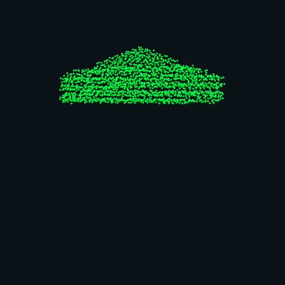

  
   
  

 

<table align="center" width="100%">
  <tr>
    <td width="50%" align="center" valign="top">
      <h4><code>VISUAL.MAP</code></h4>
      
    </td>
    <td width="50%" valign="top">
      <h4><code>SYSTEM.INFO</code></h4>
      <pre>
┌─[richjj98@kali]─[~/whoami]
├── Subject ......... Richjj98
├── Role ............ Desenvolvedor Júnior
├── Focus ........... Pesquisa de Vulnerabilidades & Pentest
├── Status .......... Disponível para novos desafios
├── Origin .......... Brasil
└── ToolChain ....... Nmap · Burp · Wireshark
      </pre>
    </td>
  </tr>
</table>

 

## 🛠️ core.stack

  
  
  
  
  
  
  

 

## 📊 github.stats

  
  

  

 

## 🎯 projects.list

| Projeto | Descrição | Stack |
|---|---|---|
| [nome-do-projeto-1](https://github.com/Richjj98) | Ferramenta / Automação de Pentest | `Python` `Nmap` |
| [nome-do-projeto-2](https://github.com/Richjj98) | Script de Automação / Recon | `Bash` `Linux` |
| [nome-do-projeto-3](https://github.com/Richjj98) | Análise de Vulnerabilidades Web | `Burp Suite` |

 

## 📡 contact.grid

  
  
  

